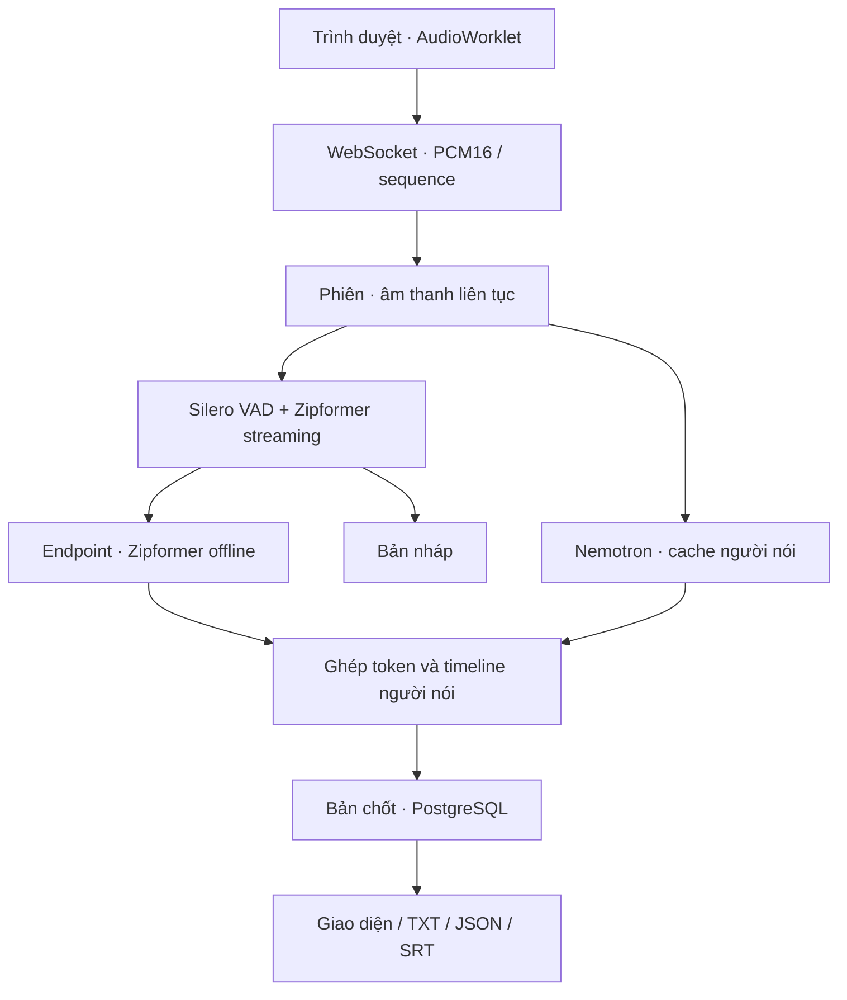

# Kiến trúc bản 0.1

1. Browser yêu cầu AudioContext 16 kHz; browser resample input thiết bị về rate này. AudioWorklet trộn mono, pack little-endian PCM16, mỗi 100 ms. Không dùng MediaRecorder/Opus nên không có vòng mã hóa/giải mã gây lệch timestamp.
2. Mỗi phiên có online ASR stream, Silero state, Nemotron speaker cache, cursor STFT và audio buffer riêng. Model weights dùng chung trong một process. Lock bảo vệ inference chung; xử lý nặng chạy ngoài event loop.
3. Nemotron nhận các cửa sổ âm thanh overlap theo `processor.audio_chunk_start`. Chỉ frame output mới vào timeline; không reset diarizer theo endpoint ASR. Frame rate lấy từ feature extractor (10 ms ở model đã pin).
4. Online ASR hiển thị draft. Silero gate lọc đoạn không có speech. Endpoint VAD hoặc trần 12 giây đóng đoạn, rồi offline Zipformer nhận dạng lại vùng có speech kèm 100 ms context. Timestamp được dịch bù về vị trí trong phiên. Endpoint theo VAD giúp tránh RNNT lookahead cắt vào lời người tiếp theo.
5. Đợi timeline người nói bao phủ cuối đoạn rồi gán từng token. Điểm gán dựa trên tỷ lệ frame hoạt động; gần hòa/overlap giữ `null`. `speaker_score` là tỷ lệ occupancy, **không phải xác suất danh tính đã được calibration**.
6. Chỉ sau bước refine + diarization mới phát `final`. Final được commit trước khi gửi. `segment_id` tăng trong phiên, không cập nhật lại final. Silence có thể tạo final rỗng để đóng segment; UI bỏ nội dung rỗng.
7. Buffer audio chỉ giữ đoạn đang xử lý và cửa sổ cần cho diarizer. Timeline cũ được prune sau khi gán xong. Speaker cache của model tự giới hạn; UI/DB transcript tăng theo độ dài cuộc trò chuyện.

## Vòng đời và giới hạn

- Một WebSocket = một phiên. Mặc định tối đa một phiên, tối đa 2 giờ, timeout không nhận audio 30 giây.
- Audio packet có sequence tăng từ 0. Duplicate đã xử lý chỉ ACK lại; gap bị lỗi, không tự điền im lặng. ACK nghĩa packet đã xử lý, không phải transcript đã final.
- Uvicorn queue giới hạn 16 frame; mỗi frame tối đa 8192 byte, parser cho tối đa 200 ms PCM. Browser dừng với thông báo nếu quá 50 gói chưa ACK hoặc buffer mạng quá mức; không âm thầm loại audio.
- `end` flush audio cuối và chốt DB trước `done`. Nếu ngắt kết nối, server cố flush nhưng không thể gửi kết quả qua socket đã đóng; xem lại REST.
- Không hỗ trợ resume stream/cache sau mất kết nối. UI không tự gửi lại audio vào phiên mới. Duplicate handling chỉ trong cùng socket/phiên.
- Đổi tên là mapping riêng `speaker_id → display_name`. Không làm thay đổi token đã final.

## Những việc chưa nằm trong bản này

Batch inference GPU giữa nhiều phiên, nhiều worker, hàng đợi phân tán, RBAC, nhận dạng danh tính qua voice enrollment, punctuation/ITN, speech separation và multi-channel routing. Có thể bổ sung sau benchmark. Các chỗ thay model được tách trong `backend/vietvoice/models.py`.
